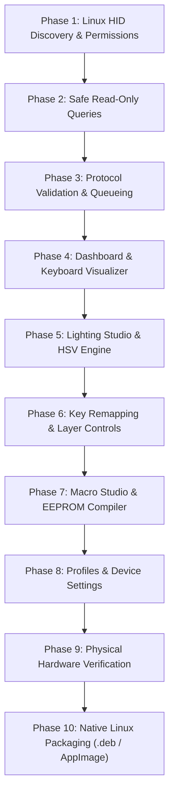

# MK1300 V2 - Linux Implementation Roadmap

This roadmap defines the sequential development, testing, and deployment phases for the **MK1300 V2 Native Linux Desktop Application**.

---

## Phase Overview

---

## Phase Breakdown

### Phase 1: Linux HID Discovery & Permissions
- **Objective**: Establish native C-FFI `hidapi` connection on Linux to identify VID `0x36AE` and PID `0xFE12` on Interface 1 without root privileges.
- **Required Modules**: `lib/hardware/hid/hid_device.dart`, `lib/hardware/hid/hidapi_binding.dart`, udev rule `99-keyboard-studio-mk1300.rules`.
- **Acceptance Criteria**: App detects connected device or activates `MockHidDevice` with graceful error catching.
- **Tests**: FFI library load unit test, mock fallback test.
- **Risks**: Missing `libhidapi-hidraw.so` on user system; mitigated by dynamic library search order.

### Phase 2: Safe Read-Only Queries
- **Objective**: Query device hardware configuration (`CMD 0x06, 0x05`) and active lighting state (`CMD 0x06, 0x0A`) without writing changes.
- **Required Modules**: `lib/hardware/protocol/packet_builder.dart`, `lib/hardware/services/keyboard_service.dart`.
- **Acceptance Criteria**: Hardware version, serial number, and battery status parsed into `KeyboardConfig`.
- **Tests**: Response byte parsing unit tests.
- **Risks**: Unexpected firmware response framing; mitigated by bounds checking.

### Phase 3: Protocol Validation & Queueing
- **Objective**: Implement thread-safe asynchronous `CommandQueue` enforcing single-flight command execution and timeout guards.
- **Required Modules**: `lib/hardware/protocol/command_queue.dart`.
- **Acceptance Criteria**: Concurrent commands executed sequentially with $\ge 10\text{ ms}$ spacing and 1000ms timeout recovery.
- **Tests**: Queue race-condition tests.
- **Risks**: Device freeze under rapid command bursts; mitigated by queue serialization.

### Phase 4: Dashboard & Keyboard Visualizer
- **Objective**: Build the 61-key canvas visualizer with real-time switch illumination and top-bar status badges.
- **Required Modules**: `lib/features/dashboard/`, `lib/features/key_remapping/presentation/keyboard_visualizer.dart`, `lib/shared/widgets/app_shell.dart`.
- **Acceptance Criteria**: Accurate ANSI 60% switch coordinates rendered; top bar displays battery, connection, profile, and layer badges.
- **Tests**: Widget visualizer layout tests.
- **Risks**: Aspect ratio scaling on different display resolutions; mitigated by `FittedBox` constraints.

### Phase 5: Lighting Studio & HSV Engine
- **Objective**: Connect all 22 lighting modes, sliders, 8 swatches, and custom color dialog with live unsolicited event decoders.
- **Required Modules**: `lib/features/lighting/`, `lib/core/utils/color_utils.dart`.
- **Acceptance Criteria**: Setting lighting dispatches `CMD 0x06, 0x0B`; receiving `0xAA, 0xFA` updates UI controls reactively.
- **Tests**: `ColorUtils` HSV math tests, packet builder serialization tests.
- **Risks**: Mode parameter mismatches (e.g. sending direction to static mode); mitigated by `LightingMode` metadata table.

### Phase 6: Key Remapping & Layer Controls
- **Objective**: Enable key customization for both Main and Fn layers across standard keys, media, mouse, and shortcut categories.
- **Required Modules**: `lib/features/key_remapping/`, `lib/core/constants/key_codes.dart`.
- **Acceptance Criteria**: Selecting key and assigning function writes atomic `CMD 0x06, 0x10` packet and updates UI legend.
- **Tests**: Key descriptor byte packing tests.
- **Risks**: Overwriting crucial keys like `Fn` or `Enter`; mitigated by resetting/locking safeguards.

### Phase 7: Macro Studio & EEPROM Compiler
- **Objective**: Enable 16 macro slots, live keystroke recorder, fixed delay insertion, and 4KB EEPROM compilation.
- **Required Modules**: `lib/features/macros/`.
- **Acceptance Criteria**: Compiling macros and reading them back yields identical keycodes and millisecond delays; chunked write succeeds.
- **Tests**: 4096-byte roundtrip compilation unit test.
- **Risks**: Macro overflow past 4KB; mitigated by pre-compile byte counting.

### Phase 8: Profiles & Device Settings
- **Objective**: Manage hardware profile switching (P1, P2, P3), auto-sleep intervals, diagnostics, and factory reset.
- **Required Modules**: `lib/features/settings/`.
- **Acceptance Criteria**: Switching profile sends `CMD 0x06, 0xFB`; factory reset requires modal confirmation.
- **Tests**: Profile and sleep packet tests.
- **Risks**: Accidental factory reset; mitigated by explicit user confirmation dialog.

### Phase 9: Physical Hardware Verification
- **Objective**: Connect physical MK1300 V2 keyboard on Linux to verify EEPROM persistence and live shortcut broadcasting.
- **Acceptance Criteria**: Persistence across power cycle; unsolicited `Fn` shortcut events received and updated in UI.
- **Tests**: Physical USB hardware validation suite.
- **Risks**: Non-destructive operation only; firmware flashing opcodes (`0x55`, `0x5A`) completely removed.

### Phase 10: Native Linux Packaging (.deb / AppImage)
- **Objective**: Build reproducible `.deb` package and standalone universal AppImage bundling `libhidapi` and udev rules.
- **Acceptance Criteria**: Package installs cleanly on standard Ubuntu/Debian without manual permission errors.
- **Tests**: Clean VM installation and removal tests.
- **Risks**: Missing GTK runtime dependencies on non-standard distros; mitigated by AppImage bundling.
