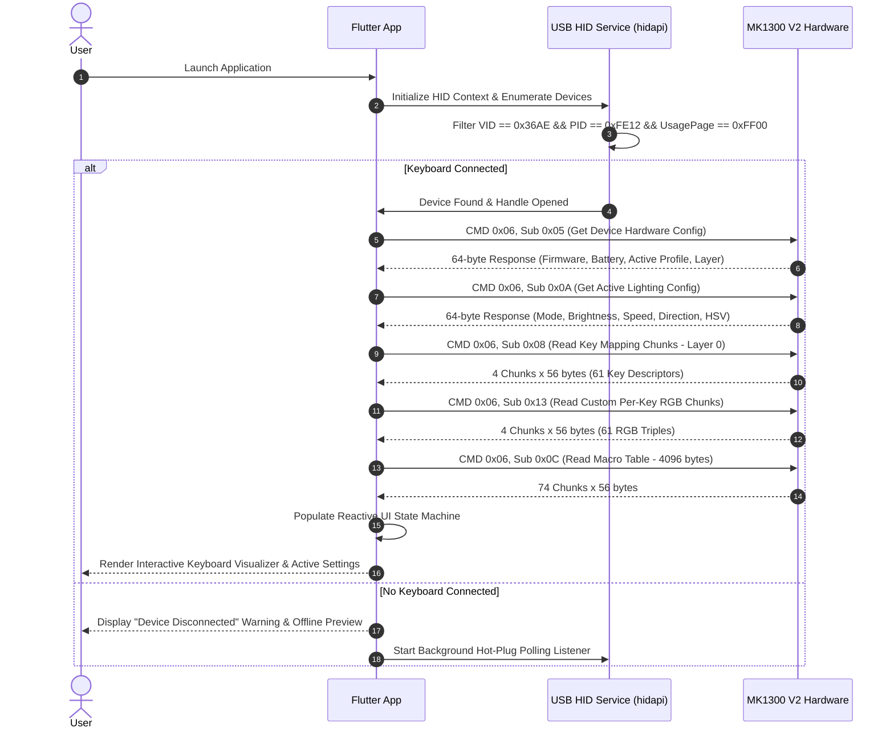
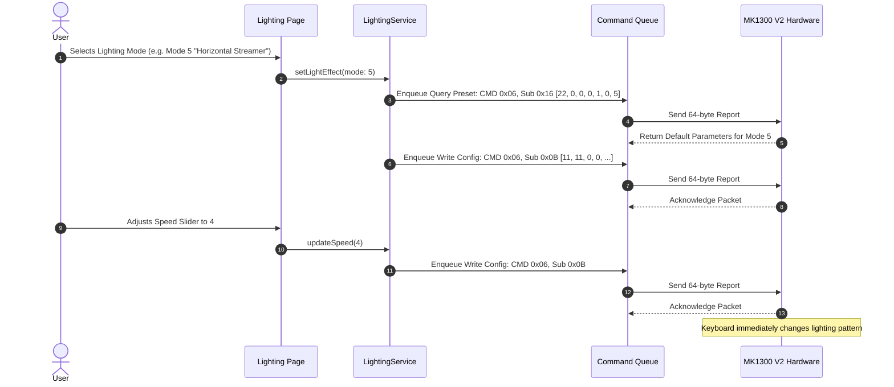
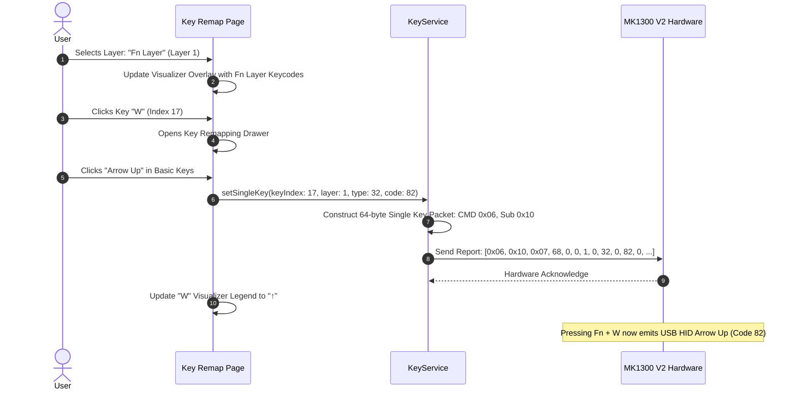
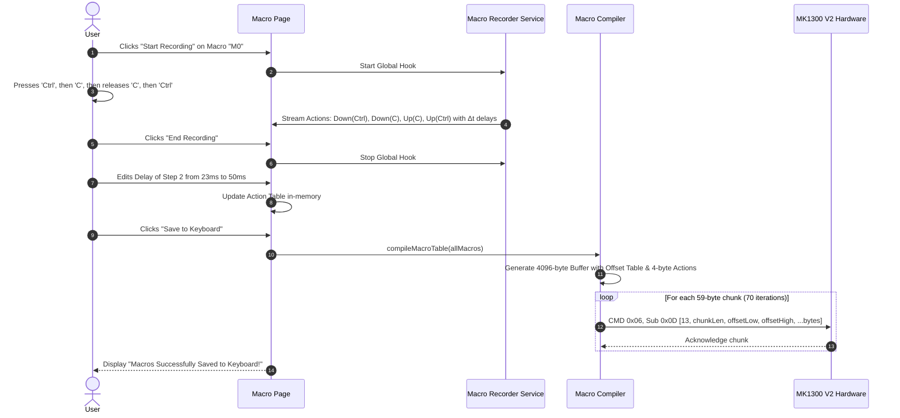

# Application Workflows: Ant Esports MK1300 V2

## 1. Workflow 1: Application Startup & Device Handshake

---

## 2. Workflow 2: RGB Lighting Configuration

---

## 3. Workflow 3: Single Key Remap & Multi-Layer Assignment

---

## 4. Workflow 4: Macro Recording, Editing & Flashing

---

## 5. Workflow 5: Profile Switching

1. User clicks the Profile dropdown in the top bar (Profile 1, 2, or 3).
2. App dispatches `CMD 0x06, Sub 0xFB, [profileIndex]`.
3. Keyboard switches its internal active memory bank.
4. App automatically re-queries Key Infos (`Sub 0x08`), Lighting Config (`Sub 0x0A`), and Custom Colors (`Sub 0x13`) to refresh the visualizer with the new profile's settings.
